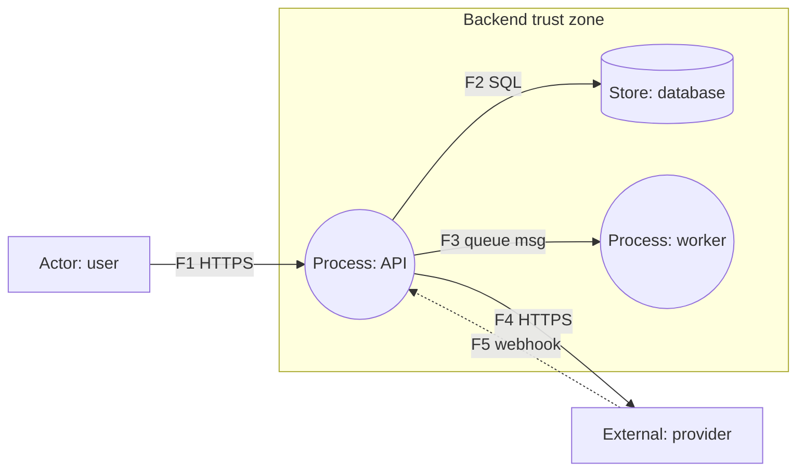

# Threat Model Template

Copy the skeleton into `docs/security/threat-model-<feature>.md` (or the path the project guide names). Fill every table; delete rows that do not apply.

## Rating Scale

Likelihood x impact on a 3-point scale. Order work by the product; do not read it as a probability.

| Score | Likelihood | Impact |
| :---: | :--- | :--- |
| 1 | Needs insider access or rare conditions | Minor: no sensitive data, easy recovery |
| 2 | Needs some skill or an account; plausible | Limited: one user or one tenant, or reversible harm |
| 3 | Easy, public, or already seen in the wild | Severe: many users, money, credentials, or regulated data |

| Product | Level | Action |
| :---: | :--- | :--- |
| 6-9 | High | Mitigate before release; test required |
| 3-4 | Medium | Mitigate or accept with a named owner |
| 1-2 | Low | Accept; note in the register |

## 1. Scope

| Field | Value |
| :--- | :--- |
| Feature / service | |
| Model author, date | |
| Design link | |
| In scope | |
| Out of scope | |
| Status | draft / reviewed / accepted |

## 2. Assets and Actors

| Asset | Why it matters | Class (credential, PII, money, tenant data, availability) |
| :--- | :--- | :--- |
| | | |

| Actor | Trust level | Goal if hostile |
| :--- | :--- | :--- |
| Anonymous | none | |
| Authenticated user | low | |
| Admin / operator | high | |
| Third-party provider | partial | |

## 3. Data-Flow Diagram

| Flow | From | To | Data | Crosses boundary | Protocol / auth | Verified or assumed |
| :--- | :--- | :--- | :--- | :---: | :--- | :--- |
| F1 | | | | yes / no | | |

## 4. Trust Boundaries

| Boundary | Between | What changes at the crossing |
| :--- | :--- | :--- |
| B1 | Internet and API edge | Identity must be established |
| B2 | API and database | Tenant scoping enforced by query |

## 5. Threat Register

| ID | Element / flow | STRIDE | Threat (attacker can ... so that ...) | L | I | L x I | Level |
| :--- | :--- | :---: | :--- | :---: | :---: | :---: | :--- |
| T-01 | | | | | | | |

## 6. Abuse Cases

| ID | Attacker goal | Cheapest path | Legit-feature abuse? | Linked threats |
| :--- | :--- | :--- | :---: | :--- |
| A-01 | | | | T-01 |

## 7. Mitigations and Controls

| Threat | Mitigation | Implemented by (skill / rule) | Control (what, where) | Test case | Status |
| :--- | :--- | :--- | :--- | :--- | :--- |
| T-01 | | | | | planned / done / monitored |

## 8. Residual Risk

| Threat | Residual level | Why accepted | Owner | Review date | decision-log entry |
| :--- | :--- | :--- | :--- | :--- | :--- |
| | | | | | DEC-n |

## 9. Revisit Triggers

- New trust boundary, client type, or privilege level.
- New data class or change in retention or sharing.
- New third party or a vendor change of terms or API.
- Incident, near miss, or audit finding in this area.
- Any High residual risk reaching its review date.

## 10. Review Record

| Reviewer | Role | Date | Outcome |
| :--- | :--- | :--- | :--- |
| | | | |
