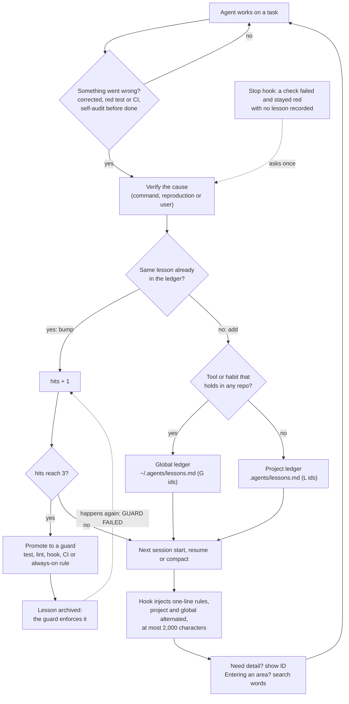

# Learning From Mistakes

Every agent that uses the arsenal learns from its verified mistakes, in every project. The model itself does not change between sessions; a ledger of mistakes does, and the agent reads it at the start of each session. A mistake that keeps coming back is turned into a guard (a test, lint rule, hook or CI check) that blocks it mechanically.

The procedure is the [`lessons-learned`](../.agents/skills/lessons-learned/SKILL.md) skill; the script is `.agents/skills/lessons-learned/scripts/lessons.py` (Python 3, standard library only). Format, ranking and promotion details are in its [reference](../.agents/skills/lessons-learned/references/lesson-format-and-promotion.md).

## The loop



| Step | What happens | Command |
| :--- | :--- | :--- |
| Record | A verified mistake becomes one line: mistake, cause, rule, check. Secrets are refused; a near-duplicate counts as a repeat instead of a new line; writes are locked, so parallel sessions lose nothing. | `lessons.py add --tags T --mistake M --cause C --rule R --check K [--global]` |
| Repeat | The same mistake again raises its hit count; an archived lesson returns to Active. | `lessons.py bump ID` |
| Load | At session start, resume, clear and compact the hook prints the most relevant lessons as one-line rules. | `lessons.py active --hook` |
| Look up | Rules only by default; the full lesson on demand. | `lessons.py search WORDS [--full]`, `lessons.py show ID` |
| Promote | At three hits the lesson becomes a guard and stops being injected. If it recurs, the script prints `GUARD FAILED`. | `lessons.py promote ID [--as test \| --guard PATH]` |
| Share | A lesson about a tool or habit moves to the global ledger, which every project reads. | `lessons.py globalize ID` |

## Two ledgers

| Ledger | Path | Holds | Ids |
| :--- | :--- | :--- | :--- |
| Project | `.agents/lessons.md` (`$LESSONS_FILE` overrides); commit it so the team shares it | Mistakes tied to this project's files, schema, services or conventions | `L001`... |
| Global | `~/.agents/lessons.md` (`$LESSONS_GLOBAL_FILE` overrides); never inside a repository | Tool and habit lessons that hold in any repository (a git flag, a shell trap, "read before editing") | `G001`... |

Each ledger keeps at most 15 Active lessons; when the cap is reached, the least repeated one moves to Archive, where `search` still finds it.

## What it costs in context

Listings print each lesson as its id, tags, hit count and rule, about a quarter of the full line:

```text
- G006 [bash,set-e,pipefail] x2: Under set -e write conditionals as if/then and end every script with a status line.
```

The session-start output is capped at 2,000 characters (about 500 tokens). Project and global lessons are ranked separately (the three most repeated first, then by how well their tags and words match the files changed in the working tree and the last five commits) and then alternated, so many repeated global lessons never push every project lesson out. A final `(+N more: lessons.py search <words>)` line says how many did not fit.

| Measured ([BENCHMARK.md](BENCHMARK.md)) | Full lines (1.3) | One-line rules (1.4) |
| :--- | ---: | ---: |
| Session start, empty ledger | 426 chars, 106 tokens | 347 chars, 87 tokens |
| Session start, 15 lessons at the field cap | 3,251 chars, 813 tokens | 1,711 chars, 428 tokens |

On a real pair of ledgers (15 project and 15 global lessons), session start showed 7 lessons in 1,905 characters where full lines showed 5 in 3,543, and `search` for a common word fell from 5,268 to 1,868 characters.

## Every agent

| Agent | How lessons load |
| :--- | :--- |
| Claude Code (plugin) | Nothing to do: `hooks/hooks.json` runs the session-start hook, and `hooks/guard.py` asks for a lesson when a check failed and never passed again in the session. |
| Codex CLI, Gemini CLI, Cursor, GitHub Copilot, Antigravity | `./install.sh --global --target <agent> --hooks` registers the session-start hook and the stop gate (see [TARGETS.md](TARGETS.md#hooks-for-the-other-agents---hooks)). |
| Any other agent | One line in its instruction file: "At session start run `python .agents/skills/lessons-learned/scripts/lessons.py active --hook`; after a verified mistake run `lessons.py add ...`." |

## Limits

- Lessons help only when they are loaded; an agent that ignores its instruction file never sees them.
- Matching is by tags and words, not meaning: a lesson phrased differently from the task may not rank high. `search` with the stack's words finds it.
- The stop gate sees only commands whose exit code it can read: a pipeline such as `pytest | tail` hides the failure.
